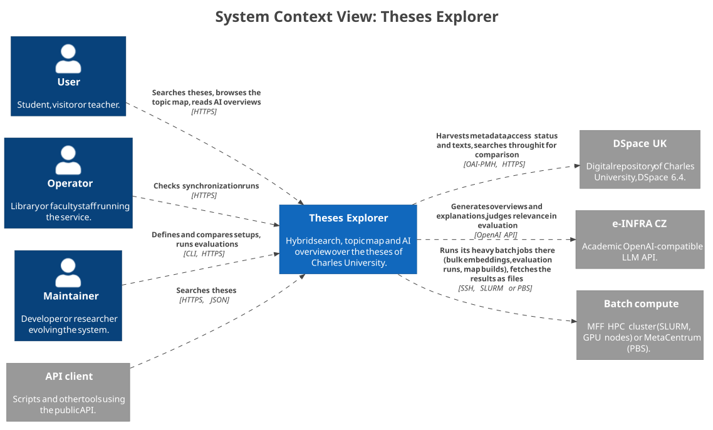
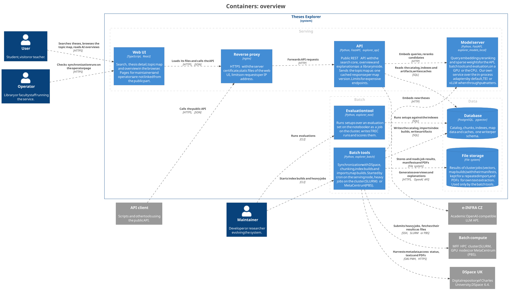
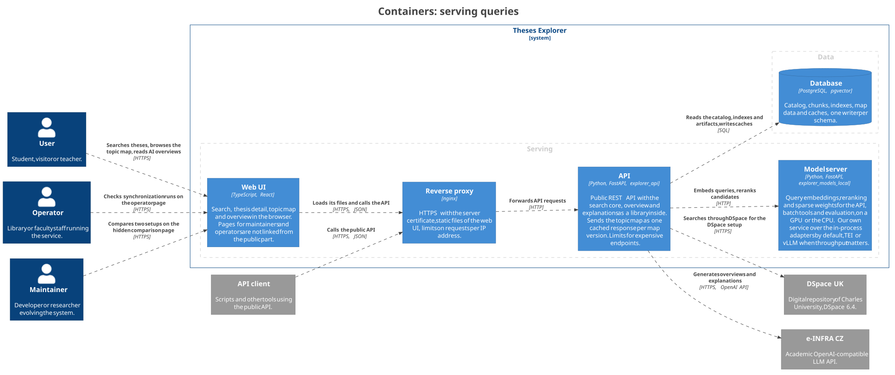
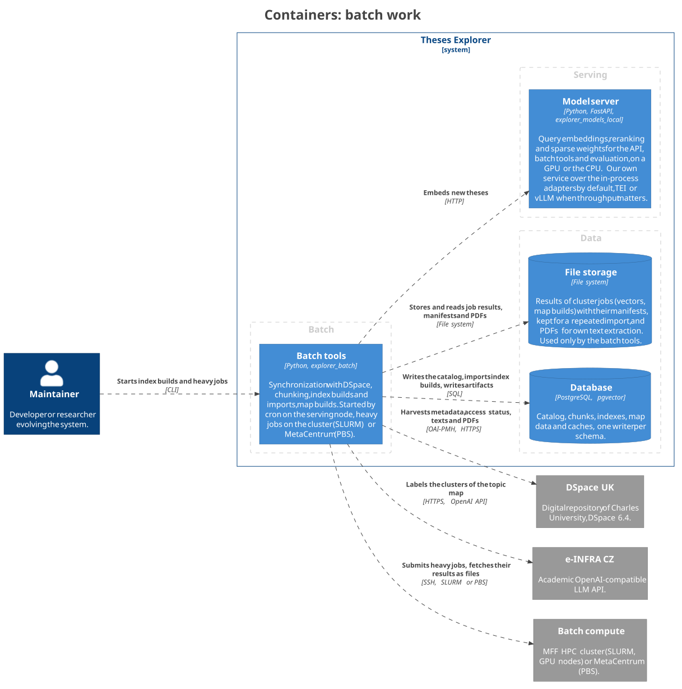
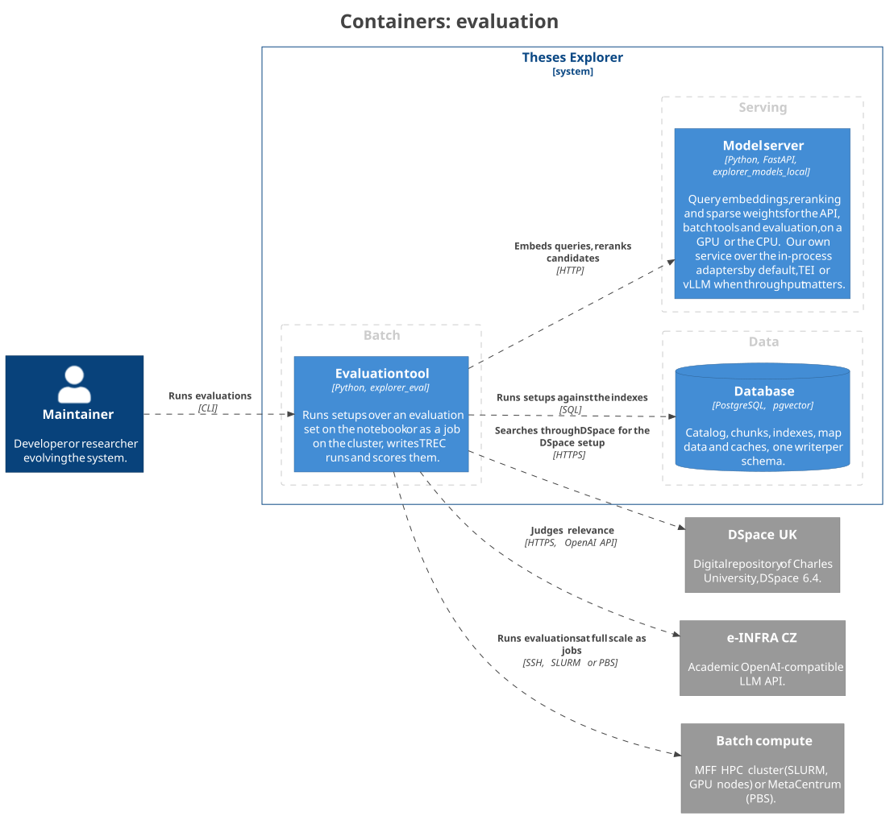
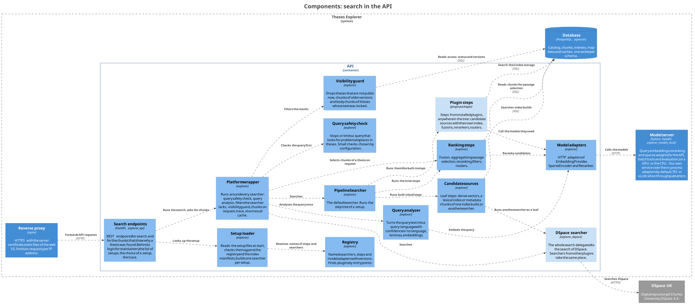
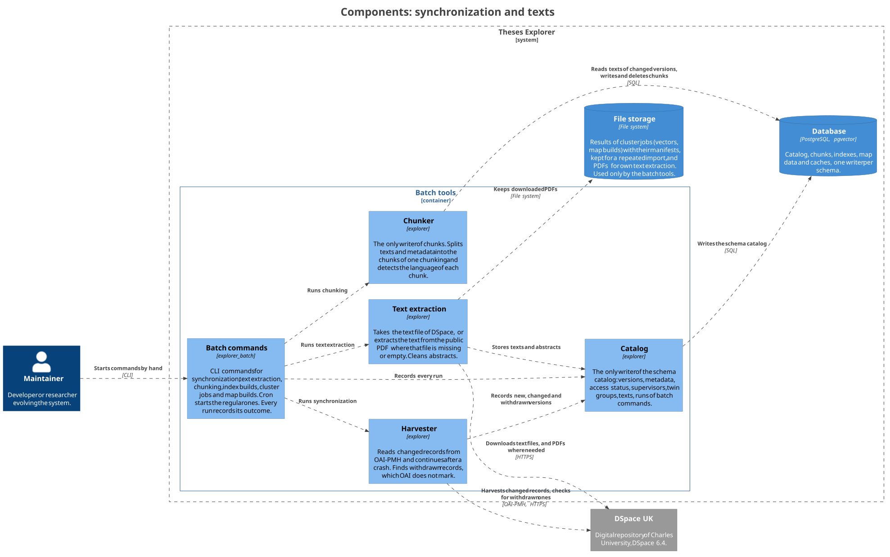
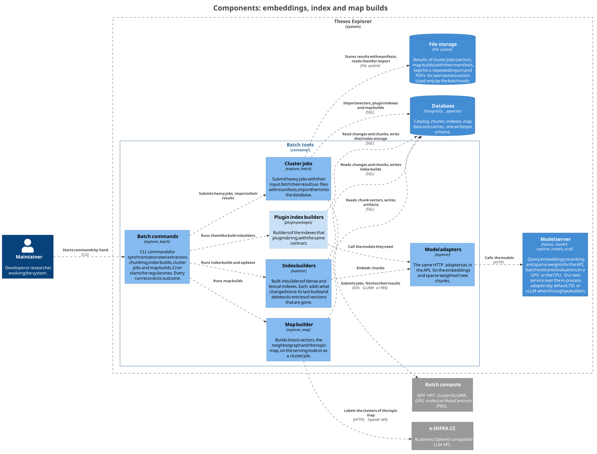
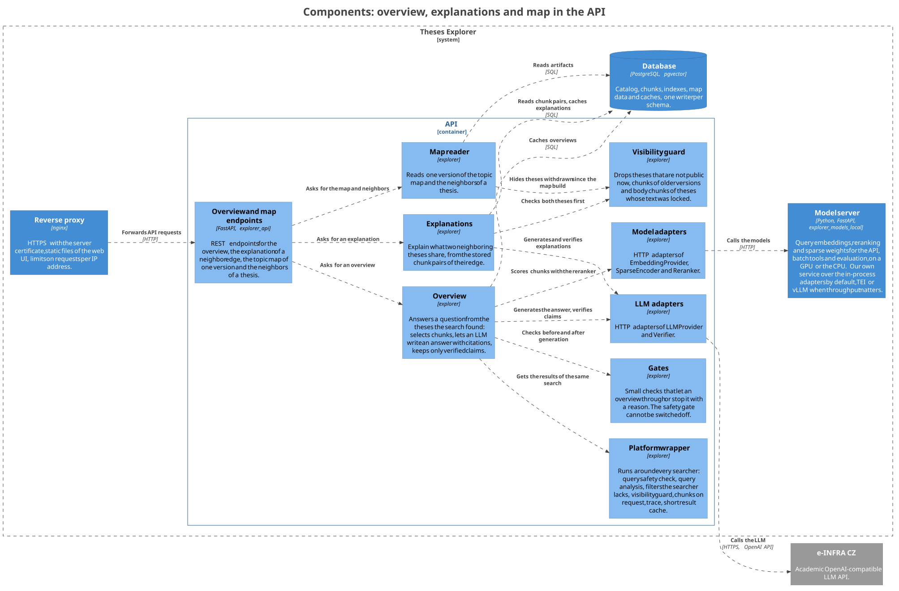

# Architecture

How the system is put together and why. Diagrams come from the C4 model in
[workspace.dsl](workspace.dsl), and [diagrams/render.sh](diagrams/render.sh) renders them
into [diagrams/](diagrams/). Choices between alternatives live in
[design decision records](decisions/). Renaming a component here means renaming it in
code and in the thesis text too.

Chapters marked *pending* are not written yet. Their draft, in Czech, is
`architektura-nastrel.md` in the
[diplomkaManagement](https://github.com/dracekmartin/diplomkaManagement) repo.

## 1. Goals and constraints

The system makes the theses of Charles University accessible in three ways, as set by the
[assignment](assignment.md): hybrid semantic and lexical search that works across
languages, an interactive map of the corpus with generated explanations of why two theses
are similar, and an AI overview that answers a question from cited theses. Who uses it
and for what is in the [use cases](use-cases.md).

Quality goals, in the order that decides a conflict:

1. Replaceable and comparable parts: embedding models, search strategies and whole
   search engines can be swapped and compared on a fixed evaluation set (assignment,
   UC11).
2. Simple for users: search and the user interface stay simple. The public interface
   knows only the default setup, and tools for maintainers are not linked from it.
3. Faithful to the source: what DSpace does not publish, the system neither finds nor
   shows. Errata, embargoes and withdrawn theses reach the index (UC10).
4. Reproducible: every result records the evaluation set, the setup, the model revision
   and the index build it came from, so it can be repeated.
5. Fast and affordable: results within a few seconds (UC1), on hardware the university
   can provide.
6. Operable by one person on a single serving node.

Constraints:

- One developer. The system is a prototype ready for deployment: it does not have to run
  in production, but it has to be shown that it could.
- The system uses only self-hosted open source components and academic services, no
  commercial APIs.
- The system indexes full text only where DSpace publishes it openly. Metadata of every
  record DSpace shows publicly is searchable too, as in DSpace.
- The serving node is not known yet. Heavy batch jobs (bulk embeddings, evaluation runs
  at full scale, builds of the topic map) run on the MFF HPC cluster, which schedules jobs
  with SLURM and offers GPU nodes. MetaCentrum, scheduled with PBS, is the alternative.
  Light batch work runs on the serving node.
- Languages and stack: Python and TypeScript ([0001](decisions/0001-languages-and-stack.md)),
  Docker Compose ([0002](decisions/0002-containerization.md)). The cluster has no Docker,
  so batch jobs there run the same images under Podman or Apptainer
  ([0005](decisions/0005-batch-jobs-on-the-faculty-cluster.md)).

## 2. Context



| Who or what | Relation to the system |
| --- | --- |
| User (student, visitor, teacher) | searches theses, browses the topic map, reads AI overviews in a web browser |
| Operator | watches the outcome of synchronization runs with DSpace and steps in when one reports a problem |
| Maintainer | defines and compares search setups, runs evaluations |
| API client | scripts and other tools using the public API. An MCP adapter for AI assistants is a later idea, outside the current use cases |
| DSpace UK | source of thesis metadata, access status and texts: OAI-PMH in the xoai format and files over HTTPS. Its own search serves as one setup for comparison. DSpace 6.4, read only |
| e-INFRA CZ | academic OpenAI-compatible LLM API for overviews, explanations and relevance judgments in evaluation. For batch work such as relevance judgments, a self-hosted LLM on the faculty cluster can replace it |
| Batch compute | MFF HPC cluster (SLURM, GPU nodes) or MetaCentrum (PBS). The system's own heavy batch jobs run there: bulk embeddings, evaluation runs at full scale, builds of the topic map. Results come back as files |

## 3. Containers



The containers fall into three groups. The batch tools write the database, and the API
reads it. File storage holds only what the batch tools bring in or work from. The overview
shows every container and everyone outside the system, but leaves out some relations
whose target already has another arrow. The three views below show every relation of
one part of the system.

Serving queries:



Batch work:



Evaluation:



| Container | Responsibility | Technology |
| --- | --- | --- |
| Web UI | search, thesis detail, topic map and overview in the browser. Pages for maintainers and operators are not linked from the public part | TypeScript, React |
| Reverse proxy | HTTPS with the server certificate, static files of the web UI, limits on requests per IP address. Requests go on to the API as plain HTTP inside the server | nginx |
| API | public REST API with a version in the path (`/v1`). The search core, the overview and the explanations run inside it as a library. It sends the topic map as one response per map version. Limits for expensive endpoints and for parallel GPU and LLM work | Python, FastAPI |
| Model server | query embeddings, reranking and sparse weights for the API, the batch tools and the evaluation tool, on a GPU or on the CPU. By default it is our own service: it offers the in-process adapters over HTTP with the same endpoints as TEI. TEI or vLLM can take its place when throughput matters. On the notebook and in tests the models can run inside the program instead ([0004](decisions/0004-models-at-query-time.md)) | Python, FastAPI |
| Database | catalog, chunks, indexes, map data and caches | PostgreSQL with pgvector |
| File storage | results of cluster jobs (vectors, map builds) with their manifests, kept for a repeated import, and PDFs for own text extraction. Only the batch tools use it | file system |
| Batch tools | synchronization with DSpace, chunking, index builds and imports, map builds. Cron starts them on the serving node, heavy jobs run on the cluster (SLURM) or MetaCentrum (PBS) ([0005](decisions/0005-batch-jobs-on-the-faculty-cluster.md)) | Python |
| Evaluation tool | runs setups over an evaluation set on the notebook or as a job on the cluster, writes TREC runs and scores them | Python |

Each schema of the database has one writer:

| Schema | Writer | Contents |
| --- | --- | --- |
| `catalog` | batch tools (synchronization, text extraction, records of runs) | theses, versions, metadata, supervisors, twin groups, extracted texts, access status, runs of batch commands |
| `chunks_<chunking>` | batch tools (chunking) | the chunks of one chunking, shared by every index build that uses it |
| `index_<build>` | batch tools (index builds, imports, plugins through their index storage) | one schema per index build: its manifest, vectors and their index, lexical postings or the data of a plugin |
| `artifacts` | batch tools (map builds) | thesis vectors, neighbor graph with the chunk pairs of its edges, versions of the topic map with clusters and labels |
| `cache` | API | search results for a few minutes, overviews, explanations |

The topic map lives only in `artifacts`. The API sends the map of one version to the
browser as one response. A map version never changes, so browsers may cache the response
for a long time.
Cached overviews and explanations record the versions of the theses they cite. The API
drops an entry when one of those theses changed, was withdrawn or lost its public text,
both when it reads the entry and in a periodic cleanup, so the cache keeps a single
writer.

### Code packages

The Python code is a uv workspace. A component gets a package of its own only when it has
heavy dependencies such as torch, runs as a program of its own, or is a plugin that shows
replaceability. Other components are folders inside a package. Where the packages live in
the repository and how the workspace is set up is decided in the engineering records
(numbers from 0010).

| Package | Contents | May depend on |
| --- | --- | --- |
| `explorer` | the core library: domain model, catalog and harvest, texts and chunks, indexes and their PostgreSQL backends, the search core, model interfaces and HTTP adapters, overview, explanations, reading map artifacts | no other package of the workspace |
| `explorer_models_local` | in-process model adapters with torch, and the model server that offers them over HTTP | `explorer` |
| `explorer_map` | builds of thesis vectors, the neighbor graph and the topic map (umap-learn, hdbscan, faiss) | `explorer` |
| `explorer_api` | the API program | `explorer`, and `explorer_models_local` only as an optional extra |
| `explorer_batch` | the batch tools | `explorer`, and `explorer_models_local` and `explorer_map` only as optional extras |
| `explorer_eval` | the evaluation tool | `explorer`, and `explorer_models_local` only as an optional extra |
| `explorer_dspace` | plugin: the whole search delegated to the search of DSpace | `explorer` |
| `explorer_sparse` | plugin: a candidate source over learned sparse token weights from any SparseEncoder, with its own index | `explorer` |

The core never imports torch. Programs reach the in-process adapters and the plugins only
through the registry. The registry finds them by Python entry points, a standard way for
an installed package to announce its classes, so nothing depends on a plugin. Which
plugins a program has is a matter of installation: the development environment installs
all of them, a deployment image lists the ones its setups need. Plugins may import only
the public module `explorer.plugin`, and `explorer.testing` in their tests. The web UI is a separate TypeScript application, outside the workspace, with
an API client generated from the OpenAPI specification.

## 4. Components

### 4.1 Search core

The search core is part of the library `explorer`. The API runs it, and so does the
evaluation tool, which calls the platform wrapper directly instead of the search
endpoints. The evaluation therefore measures the same code that serves users.



Dashed boxes are plugins: separate packages that announce themselves to the registry, and
the core does not depend on them. The box Plugin steps stands for the steps of all
installed plugins, and the first of them is the sparse source in `explorer_sparse`. The
DSpace searcher is drawn as itself, because the assignment asks for a comparison with the
search of DSpace. To stay readable, the view leaves out two arrows to the database. The
setup loader reads the index manifests when the API starts and then every few minutes, and
the platform wrapper reads and writes its result cache in the schema `cache`.

| Component | Responsibility | Package |
| --- | --- | --- |
| Search endpoints | REST endpoints for search and for the chunks that show why a thesis was found. Behind a login for maintainers also the list of setups, the choice of a setup and the trace. Everyone else gets the default setup | `explorer_api` |
| Setup loader | reads the setup files when the API starts, checks them against the registry and the index manifests, and builds one searcher per setup. It refuses a setup whose index build is missing or whose query encoder does not match the index manifest. It reads the manifests again every few minutes | `explorer` |
| Registry | names of searchers, steps and model adapters, each with a version. It finds plugins by entry points | `explorer` |
| Platform wrapper | runs around every searcher: the query safety check, the query analysis, filters the searcher lacks, the visibility guard, chunks on request, the trace and a result cache for a few minutes | `explorer` |
| Query safety check | stops or limits a query that looks for problematic places in theses, such as personal data. It is a set of small checks chosen by configuration | `explorer` |
| Visibility guard | drops theses the catalog does not list as public now, chunks of older versions of a thesis, and body chunks of a thesis whose text is no longer public | `explorer` |
| PipelineSearcher | the default searcher. It runs the step tree of a setup | `explorer` |
| Query analyzer | turns the query text and the language of the UI into a query: its language with a confidence or no language, lemmas, embeddings. It computes only the embeddings the setup needs | `explorer` |
| Candidate sources | leaf steps: dense vectors, a lexical index or metadata chunks of one index build, or another searcher | `explorer` |
| Ranking steps | fusion, aggregation, passage selection, reranking, filters and routers | `explorer` |
| Plugin steps | steps from installed plugins, anywhere in the tree: candidate sources with their own index, fusions, rerankers, routers. The first one is the sparse source, a candidate source over learned sparse token weights from any SparseEncoder | plugin packages, first `explorer_sparse` |
| DSpace searcher | plugin: the whole search delegated to the search of DSpace. Searchers from other plugins take the same place | `explorer_dspace` |
| Model adapters | HTTP adapters of EmbeddingProvider, SparseEncoder and Reranker, which call the model server | `explorer` |

#### Searcher and platform wrapper

Parts are replaced on two levels. A whole search sits behind one interface, the searcher.
The default searcher is built from steps, and each step can be replaced too.

The searcher gets an analyzed query, filters and a limit on the number of results. It
returns ranked theses, each with its id, version and score, optionally with the chunks
behind the match, and a trace. The API, the evaluation tool, the overview and the
explanations call nothing else. A searcher has to return ranked theses, everything else
is optional. It reports its capabilities (filters, chunks, languages, the index it
needs).

The platform wrapper runs the query safety check and the query analyzer once, then calls
the searcher. It also adds what the searcher lacks:

- Filters: the wrapper asks a searcher without filters for more results and drops the
  ones that do not match.
- Visibility: an index can be older than the catalog, so the visibility guard checks every
  result against the current state of the catalog. It drops theses that are no longer
  public, chunks of older versions, and body chunks of a thesis whose text DSpace locked
  or put under embargo after indexing.
- Chunks: the result list carries no text of chunks. When a user asks why a thesis was
  found, the wrapper runs passage selection for that thesis, which picks its chunks
  nearest to the query. This works for searchers that return no chunks, such as DSpace,
  too.
- Trace: what each step returned and how long it took. The wrapper records it for
  maintainers and in evaluation runs.

Only maintainers may choose a setup other than the default one or ask for a trace. These
parameters sit behind a login, together with the other protection of the API
(section 7).

The query safety check runs before every searcher, and a setup cannot switch it off. The
main protection against collecting problematic content is in the overview, which would
otherwise put such content together into one answer (section 4.3).

A searcher with its own index has to remove a thesis from that index too, so that
a withdrawn thesis disappears everywhere. A new model that does the whole search, such as
another search engine or a model with its own index, is one searcher class in a plugin,
optionally with an index builder, registered under a name. The API, the web UI and the
evaluation tool stay unchanged.

#### Step tree

PipelineSearcher composes a search from steps, and every step gets the analyzed query.
A step takes ranked lists of candidates and returns one. A branch is the part of the tree
that feeds one input of a fusion, often a single candidate source. A candidate is a chunk
or a thesis with its score and rank in each branch, its language and the branches that
could see it. All steps take and return the same kind of list, so
a step fits anywhere in the tree. A whole other searcher can be a leaf, and its results
can then be fused with others or reranked.

| Step | Input | Output | Variants |
| --- | --- | --- | --- |
| candidate source | query | chunks or theses | dense vectors, lexical search (BM25) over lemmas, metadata chunks only, learned sparse weights (plugin), another searcher |
| fusion | several lists | one list | weighted RRF, weighted sum of normalized scores |
| aggregation | chunks | theses | best chunk, sum or mean of the n best chunks |
| passage selection | theses | theses with chunks | chunks of each thesis nearest to the query |
| reranking | list | rescored list | cross-encoder, later an LLM |
| filter | list | shorter list | faculty, year, type of thesis, language, supervisor |
| router | query and several branches | output of one branch | by type or language of the query |

Each step has its own depth, because the results depend on it. A candidate source
returns that many candidates. A reranker rescores that many from the top and keeps the
rest in their order, as in experiment 05. Weights and normalization belong to the fusion,
separately for each input. An aggregation states what it computes: the sum and the mean
of the n best chunks rank theses with fewer than n chunks differently.

The setup with the best score on known items in experiment 05, `bge-m3-meta-rerank`, as
a tree. Both sources search body chunks and metadata chunks. Leaves search, and every
inner node works on the output of its children:

```text
aggregation: best chunk
└─ reranking: bge-reranker-v2-m3, rescores the top 50
   └─ fusion: RRF, k = 60
      ├─ dense: bge-m3, depth 200, weight 1
      └─ lexical: lemmas cs and en, depth 200, weight 1
```

The same reranker can rerank the results of DSpace. It reads text, so passage selection
adds the chunks of each thesis inside the tree:

```text
reranking: bge-reranker-v2-m3, rescores the top 50
└─ passage selection: 2 nearest chunks per thesis
   └─ dspace: the search of DSpace
```

#### Setups and registry

A setup is a named configuration of a searcher, for PipelineSearcher its step tree. Each
setup is one TOML file in the repository. The tree is a flat list of named steps, and
each step names the steps it reads:

```toml
name = "bge-m3-meta-rerank"
output = "theses"

[steps.dense]
type = "source.dense.v1"
index = "chunks-1000.bge-m3"
depth = 200

[steps.lexical]
type = "source.bm25.v1"
index = "chunks-1000.lemmas-cs-en"
depth = 200

[steps.fused]
type = "fuse.rrf.v1"
inputs = { dense = 1.0, lexical = 1.0 }
k = 60

[steps.reranked]
type = "rerank.cross-encoder.v1"
input = "fused"
model = "BAAI/bge-reranker-v2-m3"
rescore = 50

[steps.theses]
type = "aggregate.best.v1"
input = "reranked"
```

- An index spec lies in a file of its own: chunking, model, revision, prompt. A new setup
  costs nothing, a new index spec needs a new index build.
- `setups check` checks a setup: an unknown key or step type, a reference to a missing
  step, an index without a finished build, a query encoder that does not match the index
  manifest. It prints the setup with its defaults filled in and its fingerprint. An
  unknown key is an error, so that a result never claims a setting the code did not use.
- `eval run` runs a setup over an evaluation set and writes a TREC run with the
  fingerprint.
- The fingerprint is a hash of the normalized setup and the ids of its index builds, each
  with the snapshot it covers. TREC runs and the caches of results, overviews and
  explanations record it.
- A setup with a reported result is never edited. A change makes a new file, as with
  versions of the evaluation set.
- Setups change only in the repository, the UI has no editor for them. The default setup
  is one line of the deployment configuration and changes with a restart of the API.
  A fallback setup without the reranker serves a node without a GPU.

The registry maps names with a version, such as `fuse.rrf.v1`, to searchers, steps and
model adapters. The core registers its own. A plugin announces its classes through an
entry point. Setups refer to names, never to import paths, so adding a plugin changes
nothing in the core. A plugin may add any kind of step. The sparse source is a leaf
because it brings candidates from its own index, and a plugin can as well add a fusion,
a reranker or a router inside the tree.

#### Language

Each chunk gets a language at indexing, detected from its own text. A Czech thesis
carries its English abstract in its text, and the abstract of a Slovak thesis lies in the
Czech slot of the metadata, so the language of the thesis would be wrong for many chunks.
The thesis keeps the language of its metadata for filters and display. Czech, Slovak and
English are full languages in the analysis of chunks and queries, each with its own
lemmatizer.

The query analyzer picks Czech, Slovak or English with a confidence, or decides that the
query has no language: a name, a code, an abbreviation or a formula. No language is
a valid result, not an error. For such a query the lexical source searches chunks in all
languages, because exact matches of names and codes help most there. The overview uses
the confidence to choose the language of its answer. Whether the language of the UI helps
as a guess for short queries is up to the evaluation.

A lexical source matches words, so it rarely finds a chunk in another language than the
query. For a query with a language, the fusion therefore treats a lexical source as blind
to chunks in other languages, and it knows for each candidate which branches could see
it. For a branch that searched and did not find a candidate, the fusion counts zero or
a score just below the last hit of that branch. A branch that could not see a candidate
counts the same way, or is left out of the score of that candidate. The plain sum of
experiment 05 favors theses in the language of the query. An average over the branches
that could see a candidate fixes that for queries in another language. It also lowers the
score of a thesis in the language of the query that only the dense source found.

The core is designed for every way of handling the lexical branch: the fusion rule above,
lexical search over metadata chunks only, the reranker alone, no lexical branch at all,
and translation of the query as an optional step. Translation is the only one that needs
extra work, and it may wait. The evaluation decides the default, together with the
default fusion, the size of chunks and the place of the reranker.

#### Interfaces at the points of replacement

```text
Searcher.search(query, filters, limit) -> result
Searcher.capabilities -> filters, chunks, languages, required index
QueryAnalyzer.analyze(text, ui_language) -> query: language with confidence or none,
    lemmas, embeddings
Step.run(query, inputs) -> candidates
EmbeddingProvider.embed_queries(texts), EmbeddingProvider.embed_chunks(texts)
SparseEncoder.encode(texts) -> token weights
Reranker.score(query, texts) -> scores
```

### 4.2 Indexing

The batch tools keep the catalog, the chunks and the index builds in step with DSpace.
Cron starts their regular commands on the serving node, and a maintainer starts the heavy
ones by hand. Heavy jobs run on the cluster
([0005](decisions/0005-batch-jobs-on-the-faculty-cluster.md)). Two views show the
components: one for synchronization and texts, one for embeddings, index and map builds.
Batch commands appear in both. Embeddings belong to index builds, not to synchronization:
chunks do not depend on a model, and each index spec embeds them with its own model.





| Component | Responsibility | Package |
| --- | --- | --- |
| Batch commands | CLI commands for synchronization, text extraction, chunking, index builds, cluster jobs and map builds. Cron starts the regular ones. Every run records its start, end, outcome and counts in the catalog, and the operator page shows them | `explorer_batch` |
| Harvester | reads changed records from OAI-PMH in the xoai format and continues after a crash. It also finds withdrawn records, which OAI does not mark | `explorer` |
| Catalog | the only writer of the schema `catalog`: versions of theses, metadata, access status, supervisors, twin groups, texts and the runs of batch commands | `explorer` |
| Text extraction | takes the text file that DSpace makes from the PDF, or extracts the text from the public PDF where that file is missing or empty. It cleans abstracts and takes the abstract from the text where the metadata abstract is missing or cut | `explorer` |
| Chunker | the only writer of chunks. It splits texts and metadata into the chunks of one chunking, detects the language of each chunk and deletes the chunks of versions that are gone | `explorer` |
| Index builders | built-in builders of dense and lexical indexes. Each adds what changed since its last build and deletes its own entries of versions that are gone. The lexical builder lemmatizes each chunk with the lemmatizer of its language, the same one the query analyzer uses | `explorer` |
| Plugin index builders | builders of the indexes that plugins bring, with the same contract | plugin packages, first `explorer_sparse` |
| Cluster jobs | submit heavy jobs with their input to the cluster, fetch their results as files with manifests and import them: vectors and plugin indexes into index builds, map builds into artifacts | `explorer_batch` |
| Map builder | builds thesis vectors, the neighbor graph and the topic map (section 4.3), on the serving node or as a cluster job | `explorer_map` |
| Model adapters | the same HTTP adapters as in the API, for the embeddings and sparse weights of new chunks | `explorer` |

#### Catalog and synchronization

The catalog holds every thesis record that DSpace shows publicly, as DSpace finds theses
with a locked text or with metadata only by their metadata too. Full text is used only
where DSpace publishes it.

- The harvester reads the records changed since the last run, page by page, and continues
  where it stopped after a crash. A query for a single record (GetRecord) does not work on
  DSpace UK, so the harvester always reads ranges of dates.
- The date of change in OAI moves mostly with bulk saves in DSpace, and it need not move
  when access changes, for example when an embargo ends on its date. A periodic full run
  therefore reads all records again. It compares the list of ids in OAI with the catalog,
  checks the pages of the theses, because a removed thesis can stay in OAI while its page
  answers 404, and reads the fields of access (availability of files, the reason and end
  of an embargo) of every record.
- The catalog compares the content of a record and records a new version only when the
  metadata or the files differ. The fields of access do not count, a change of access
  changes the access status of the current version.

DSpace UK does not version its records. An erratum is one more file next to the text, and
the text itself stays. A version in the catalog is therefore the state of the metadata
and files of a record as the harvester saw it. Chunks and index entries belong to one
version, and the visibility guard compares them with the current one (section 4.1).

When DSpace locks the text of a thesis, the catalog marks it as not public and the
visibility guard hides its body chunks at once. Whether the text, its chunks and its
vectors are also deleted, and how fast, is open (see Open below).

The catalog also records:

- Defence status: the field `uk.thesis.defenceStatus`, and where it is missing, the grade
  (a failed grade gives N, a recognized one U, any other grade O, no grade no status).
  Unsuccessful theses stay findable, and every attempt at a defence is a record of its
  own, as in DSpace.
- Supervisors: the name as DSpace writes it, "Surname, Name". Variants that differ only in
  a trailing comma or spaces are joined, variants that differ in diacritics only after
  a check. DSpace has no ids of persons, so namesakes stay one name.
- Twin groups: a recognized rigorous thesis with its original thesis, or several records
  of one thesis defended more than once. Search shows every record of a group, as DSpace
  does. The map, the neighbor graph and the evaluation take one record of each group: the
  last one with status O, which for a recognized rigorous thesis is its original thesis.
- Errata, shown as one more file of the thesis.
- Runs: every run of a batch command with its start, end, outcome and counts. A run of
  synchronization is a SyncRun, and the state of the catalog after it is a snapshot.

#### Texts and chunks

- The text of a thesis is by default the text file that DSpace makes from the PDF. It
  matches the text of the PDF and is about 40 times smaller. The body of a thesis is the
  file described as "Text práce". A locked file answers with a redirect to an HTML page
  instead of an error, so extraction checks what it got.
- Where the text file is missing or empty and the PDF is public, the extractor reads the
  PDF itself. PDFs are downloaded only for these theses and kept in file storage. Scans
  without a text layer would need OCR, a later extractor behind the same interface.
- Abstracts from the metadata are cleaned of HTML entities and of headers copied from the
  PDF. Half of them are cut at about 1,320 characters and some theses have none, so the
  extractor takes the abstract from the text where the metadata abstract is missing or
  cut.
- A chunking says how texts are split. The core starts with chunks of up to 1,000
  characters, as in the experiments, and the evaluation decides the final size. Each chunk
  records its thesis, version, position, source (body or metadata) and its language,
  detected from its own text.
- Metadata chunks hold the title, the keywords and the abstract, one language each.
  Theses without public text get only metadata chunks.
- Each chunking has its own schema `chunks_<chunking>`, shared by all index builds over it.
  The chunker deletes the chunks of withdrawn and older versions. Until each build over
  the chunking has caught up, the visibility guard hides its entries of those versions.

#### Index builds

An index spec says what an index is built from: a chunking and an encoder (model,
revision, prompt, dimension) or an analyzer. An index build is one built instance in its
own schema `index_<build>`, with a manifest: the spec, the model and its revision, the
snapshot the build covers, counts, and where and when it was built.

Every builder keeps the same contract:

- It asks the catalog which versions to add and which to remove since its last build:
  new and changed versions to add, older, withdrawn and no longer public ones to remove.
  It deletes its own entries of the removed versions, so that their text does not stay in
  the index.
- It can run again without harm, and after a crash or a preempted job it continues where
  it stopped.
- Cached embeddings are keyed by a hash of the text, the chunking, the model and its
  revision. A changed text or chunking never reuses old vectors.
- The manifest records the snapshot the build covers. The setup loader in the API reads
  the manifests again every few minutes, so an update of a build changes the fingerprint
  of every setup that uses it without a restart, and a cached result never outlives the
  index it came from.

Where builds run:

- New theses go into the existing builds on the serving node. The builders embed their
  chunks through the model server.
- A full build runs as a cluster job. The job processes the corpus in shards and keeps
  its state per shard, so that a requeued job does not start again. It writes vectors with
  a manifest as files. The batch tools fetch them into file storage and import them, and
  the database on the serving node builds the vector index. A data directory is never
  copied.
- Plugin index builders keep the same contract. Their full builds run as cluster jobs too,
  and the batch tools import the results into the index storage that the core gives the
  plugin.
- A map build runs on the serving node when it fits there, otherwise as a cluster job
  whose results the batch tools import into `artifacts`.

#### Open

- How often synchronization, chunking and index updates run, and how often the map and
  the neighbor graph are rebuilt. It depends on what each step costs, so the intervals
  come after the first measurements.
- How fast a withdrawn, corrected or locked thesis has to leave the texts, indexes and
  caches, and whether backups have to forget it too. This waits for the supervisor.
- Storage at full scale: PostgreSQL with pgvector stays until a scaling test on the
  cluster shows whether it is enough, and whether the vector index needs quantization or
  a smaller form (0005).
- Whether thesis texts may stay in the storage of the cluster during jobs. This waits for
  the administrators of the cluster.
- Whether DSpace derives the defence status from the grade in the same way. The rule above
  follows what the records show.

#### Interfaces at the points of replacement

```text
Extractor.extract(version, files) -> text, or none with a reason
Chunker.chunk(text, chunking) -> chunks with position and language
Lemmatizer.lemmas(text, language) -> lemmas
IndexBuilder.changes(catalog) -> versions to add and versions to remove since its last build
IndexBuilder.build(changes) -> updated index build and its manifest
```

### 4.3 Topic map and overview

This section stays at a high level. The map builder in the batch tools builds the topic
map (section 4.2), and the API only reads it. The overview and the explanations run in
the API on top of the search.



The platform wrapper, the visibility guard and the model adapters are the components of
section 4.1, and the view of that section shows their other relations.

| Component | Responsibility | Package |
| --- | --- | --- |
| Overview and map endpoints | REST endpoints for the overview, the explanation of a neighbor edge, the topic map of one version and the neighbors of a thesis | `explorer_api` |
| Overview | answers a question from the theses the search found: selects chunks, lets an LLM write an answer with citations and keeps only the claims the verifier confirms | `explorer` |
| Gates | small checks that let an overview through or stop it with a reason. The safety gate always runs, the configuration of the overview names the others | `explorer` |
| Explanations | explain what two neighboring theses share, from the stored chunk pairs of their edge. An explanation is generated on the first request and then cached | `explorer` |
| Map reader | reads one version of the topic map and the neighbors of a thesis from `artifacts` | `explorer` |
| LLM adapters | HTTP adapters of LLMProvider and Verifier, which call e-INFRA or a self-hosted LLM | `explorer` |

#### Topic map

- There is one precomputed map of the whole university. Maps of single queries may come
  later, or never.
- The map shows only theses with full text, and one record of each twin group. Theses
  without public text are found by search, as in DSpace, but are not in the map.
- The map builder works as a chain of artifacts for one snapshot: thesis vectors, the
  neighbor graph (the k nearest theses of each thesis, computed exactly), 2D coordinates,
  layers of clusters, their labels, and the volume of topics by year. Each map step stores
  its output as an artifact with an id of its own and the parameters it ran with. A map
  version is the choice of one artifact of each step, so projection, clustering and labels
  can be replaced and compared. The deployment configuration names the map version the UI
  shows, as it names the default setup.
- Thesis vectors come from a thesis representation with a configuration of its own, built
  from the chunk vectors of an index build. A change of the search setup therefore does
  not move the map. Whether a thesis vector is the mean of its chunk vectors or the vector
  of its abstract, experiments decide.
- An LLM labels the clusters from sample theses and key phrases, from the smallest
  clusters up, one call per cluster, during the map build.
- A new snapshot gets a new map, and its layout may change. Stability between versions
  does not matter for now.
- For each edge of the neighbor graph the map builder stores the few most similar pairs of
  chunks of the two theses. The chunk vectors exist already, so this is cheap.
- The API sends the map of one version as one response (chapter 3), and the web UI draws
  it. A map version never changes, but a thesis withdrawn after its snapshot must not
  show. The API therefore sends with the map a short list of the theses withdrawn or
  locked since that snapshot, which browsers keep only briefly, and the web UI hides them.
  The neighbors of a thesis go through the visibility guard.
- The map and the search meet only through thesis ids: the results of a search are
  highlighted in the map, and the detail of a thesis opens its neighborhood. A record
  outside the map that belongs to a twin group shows the neighbors of the record that
  represents the group. Theses without public text have no neighbors, and the volume of
  topics by year starts in 2006, because older theses have no public text.

#### Explanations of neighbor edges

An explanation is generated on the first request, only from the stored chunk pairs of the
edge. The visibility guard checks both theses first, so a thesis that was withdrawn or
locked after the map build never reaches the LLM. The verifier checks the claims against
the chunks. The cache key is the pair of theses, the snapshot and the fingerprint of the
configuration of explanations (thesis representation, generator, verifier, prompt). The
cache entry records the versions of both theses, and the API drops it when one of them
changes, is withdrawn or loses its public text (chapter 3).

#### Overview

- The overview gets the same query, filters and setup as the search and works with the
  same candidates. It takes the result of the search from the short cache of the platform
  wrapper, or computes it again, because the search is deterministic.
- It is a request of its own, so the search returns its results without waiting for it.
  The overview comes as a whole, and a deployment can switch it off.
- The overview selects chunks with a limit per thesis and in total, chooses the citations
  first, and then the LLM writes the answer with the numbers of the cited chunks. The
  verifier checks each claim against its chunk, and claims without support drop out.
- Gates stop the overview with a reason. The first gate runs before generation and stops
  it when the chunks are too few or too weak. RRF gives the first candidate the same score
  for a strong and a weak match, so the overview scores its chunks with the reranker even
  when the search setup has none. The second gate runs after verification and stops an
  answer with too few supported claims. The safety gate keeps the overview from
  summarizing problematic places in theses, such as personal data. It always runs, as the
  query safety check does, and the configuration names the other gates. Each gate gets
  the query and the chunks or the verified answer and returns pass, or stop with a reason,
  so a new gate needs no change elsewhere.
- The answer is in the language of the UI, unless the query analyzer is confident that the
  query is in another language.
- The cache key is the normalized query, the filters, the language of the answer, the
  fingerprint of the setup and the fingerprint of the configuration of the overview
  (generator, verifier, prompt templates, gates and their thresholds, chunk limits, the
  reranker it uses). There is no cache by similarity of queries, because two similar
  queries can need different answers.
- The generator, the verifier, the prompt templates and the whole overview method can be
  replaced. The verifier is an LLM for now. A small NLI model, served by the model server
  like the other models, could take its place behind the same interface.

#### Open

- The thresholds of the gates come with the implementation.
- What the safety gate refuses waits for the supervisor.
- Whether theses without public text stay findable by metadata, or are left out of search
  as they are left out of the map, waits for the supervisor. The same answer decides
  whether it is enough that they have no neighbors and that the chart by year starts in
  2006.
- Pages and colors for supervisors (UC9) can stand on the catalog and the clusters of the
  map, once the names of supervisors are joined (section 4.2). Their scope in the UI is
  open.
- Which library draws the map in the browser, for example Embedding Atlas or datamapplot.

#### Interfaces at the points of replacement

```text
MapStep.run(inputs, parameters) -> artifact with its id
Explainer.explain(edge) -> verified explanation
OverviewMethod.answer(query, filters, setup, ui_language) -> verified answer with
    citations, or a stop with a reason
Gate.check(query, chunks or answer) -> pass, or stop with a reason
LLMProvider.generate(prompt) -> text
Verifier.verify(claim, chunk) -> supported or not
```

## 5. Runtime views

*Pending:* answering a query, indexing a new thesis version, a thesis withdrawn from
DSpace, an evaluation run, an overview, an explanation of a neighbor edge.

## 6. Deployment

*Pending:* development notebook, batch compute, serving node, and the hardware a full
index needs.

## 7. Crosscutting concepts

*Pending:* what the search core (4.1) shares with indexing, the map and the overview:
plugins and registry, index manifests and snapshots, visibility guard, query safety check,
access for maintainers and protection against overload, language handling.

## 8. Variability

*Pending:* what can be replaced, through which interface, at which time (configuration,
deployment, code) and at what cost.

## 9. Quality scenarios

*Pending:* change scenarios in six parts (source, stimulus, artifact, environment,
response, response measure), carried out and measured in the thesis.

## 10. Decisions

| Record | Decision |
| --- | --- |
| [0001](decisions/0001-languages-and-stack.md) | Python 3.13 and FastAPI, TypeScript and React, PostgreSQL with pgvector |
| [0002](decisions/0002-containerization.md) | Docker Compose is how the system runs |
| [0003](decisions/0003-engineering-quality.md) | engineering quality and its enforcement |
| [0004](decisions/0004-models-at-query-time.md) | models behind interfaces, adapters in process or over HTTP, one model server for all programs in deployment |
| [0005](decisions/0005-batch-jobs-on-the-faculty-cluster.md) | heavy batch jobs on the faculty cluster, results come back as files |

Planned records (numbers up to 0009 are reserved for architecture decisions): the search
core with replaceable searchers and steps, language handling, storage at full scale.

## 11. Glossary

These are working names, the final naming is still open.

| Term | Meaning |
| --- | --- |
| Thesis | one thesis record in DSpace: metadata, files, extracted text, document version |
| Catalog | the system's record of all theses: versions, metadata, files, extracted texts, access status, supervisors, twin groups and runs of batch commands |
| Chunk | a searchable piece of a thesis: a passage of the body, or a metadata chunk with the title, keywords and abstract in one language, as in the experiments. Text unit is the working name for this general notion |
| Searcher | the interface of a whole search: query, filters and a limit in, ranked theses out |
| PipelineSearcher | the default searcher, which runs the step tree of a setup |
| Setup | a named configuration of a searcher. For the default searcher it is a tree of steps |
| Step | one node of that tree: candidate source, fusion, aggregation, passage selection, reranking, filter or router |
| Branch | the part of a step tree that feeds one input of a fusion |
| Candidate | a chunk or a thesis passed between steps, with its score and rank in each branch, its language and the branches that could see it |
| Fingerprint | a hash of a normalized configuration. For a setup it includes the ids of its index builds with the snapshots they cover. Overviews and explanations have fingerprints of their own configurations. Every result records the fingerprints it depends on |
| Search strategy | the term of the assignment and of earlier documents for how ranking sources combine. Here it is the step tree of a setup |
| Query analyzer | turns the query text into a query with language and its confidence, lemmas and embeddings |
| Platform wrapper | the part of the core that runs around every searcher: query safety check, query analysis, filters, visibility guard, chunks on request, trace, result cache |
| Query safety check | small checks before every searcher that stop or limit a query looking for problematic places in theses |
| Visibility guard | drops from every result what is not public now: withdrawn theses, chunks of older versions, body chunks of theses whose text was locked |
| Trace | the record of what each step returned and how long it took |
| Index spec, index build | what an index is built from (a chunking, an encoder or analyzer) and one built instance, recorded with an index manifest (model, revision, snapshot, counts) |
| Registry | the list of named searchers, steps, model adapters and plugins that a setup can refer to |
| Plugin | a separate package that adds a searcher, a step or an index to the registry without changes to the core |
| Index storage | the schema `index_<build>` in PostgreSQL that the core gives a plugin for its own index |
| Snapshot | the state of the catalog after one synchronization run |
| SyncRun | one scheduled synchronization pass with its recorded outcome |
| Twin group | records of one work: a recognized rigorous thesis with its original thesis, or the records of several attempts to defend one thesis |
| Extractor | gets the text of a thesis version: the text file of DSpace, the PDF itself, later OCR |
| Lemmatizer | turns the words of one language into their base forms, for lexical indexes and queries |
| NeighborGraph | precomputed top-k similarity edges between theses |
| TopicMap | precomputed, versioned 2D layout of the corpus with labeled clusters |
| Thesis representation | the configuration that turns a thesis into one vector for the map and the neighbor graph, independent of the search setups |
| Map step | one replaceable step of the map builder, such as projection, clustering or labels |
| Artifact | the stored output of one map step, with its id and parameters. Chapter 9 uses the word in its other sense: the part of the system a change scenario reaches |
| Overview method | the replaceable procedure that makes an overview from a query, filters and a setup |
| Explainer | the replaceable procedure that makes the explanation of a neighbor edge |
| Explanation | generated text describing what two neighboring theses share, always cached |
| Overview | verified generated answer to a question, grounded in cited theses |
| Gate | a small replaceable check that lets an overview through or stops it with a reason |
| EmbeddingProvider, SparseEncoder, Reranker, LLMProvider, Verifier | small interfaces hiding which model runs where |

### Abbreviations and tools

| Abbreviation | Meaning |
| --- | --- |
| BGE-M3 | the multilingual embedding model of BAAI that the experiments found best. It gives one dense vector per passage and also weights of its tokens |
| BM25 | the usual ranking formula of lexical search. It scores a chunk by the query words it contains, weighted by how rare each word is in the corpus |
| C4 | a way of drawing software architecture in four levels of zoom: context, containers, components and code |
| CLI | a program run from the command line |
| HNSW | the graph index that pgvector uses to find the nearest vectors without comparing a query with every vector |
| HPC | high-performance computing, here the MFF cluster for batch jobs |
| LLM | large language model, used for the overview, the explanations and relevance judgments |
| MCP | Model Context Protocol, a standard way for AI assistants to call tools such as a search API |
| MFF | the Faculty of Mathematics and Physics of Charles University |
| NLI | natural language inference: a model decides whether one text follows from another |
| OAI-PMH | the standard protocol through which repositories hand out their metadata page by page. xoai is the metadata format DSpace offers in it |
| OpenAPI | a machine-readable description of a REST API. The web UI generates its API client from it |
| PBS | the job scheduler of MetaCentrum. A job is a script with its resource needs, submitted with `qsub` |
| pgvector | the PostgreSQL extension for vectors and nearest-neighbor search |
| RRF | reciprocal rank fusion. Each list gives a candidate 1/(k + rank), where k is a constant, usually 60, and the fusion adds these up |
| SLURM | the job scheduler of the MFF cluster, the same role as PBS. Jobs are submitted with `sbatch` |
| TEI, vLLM | servers from other projects that run models behind an HTTP API: Text Embeddings Inference from Hugging Face for embeddings and rerankers, vLLM mainly for LLMs. Either can replace our own model server |
| TOML | a plain text format for configuration files |
| TREC | Text REtrieval Conference, a long series of evaluation campaigns for search. Its formats are used here: a TREC run lists the ranked results of each query, qrels hold the relevance judgments |
| UC | a use case from [use-cases.md](use-cases.md), for example UC1 |
| uv | the Python tool that manages the packages and dependencies of the workspace |
